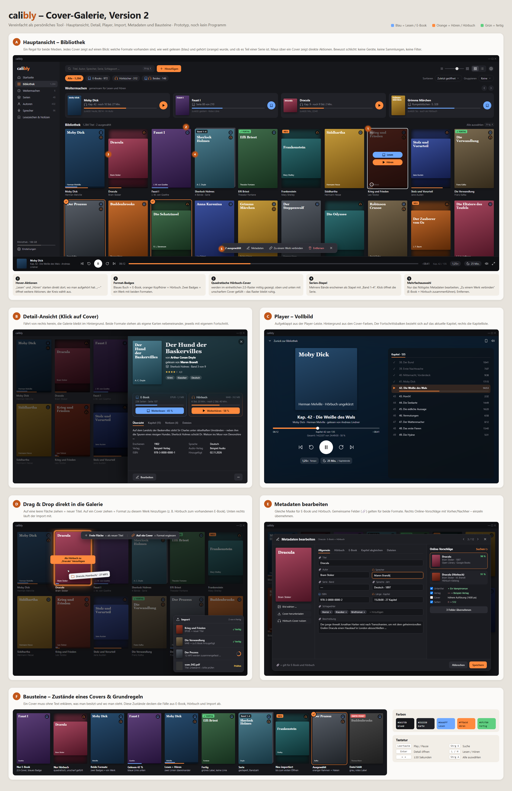

# calibly
One library for ebooks and audiobooks - calibre's library management combined with an Audibly-style audiobook player.

## Compatability
- Main Intent: Windows 11
> Should be developed with later Linux compatability in mind. Implementation in Adroid and IOS thinkable in the future. 

## Functions
- Classical calibre interface which also accepts audiobooks.
- Modify the metadata of audiobooks and ebooks the same way you can modify ebooks in calibre.
- Integrated player for audiobooks similar to Audibly.
- Integrated reader for ebooks similar to calibre.
- Importing ebooks and audiobooks by pulling the files in the interface.

## UI Mockup
Prototype of the planned cover gallery interface (not implemented yet): main library view, detail view, fullscreen player, drag & drop import, metadata editor and cover states.



## UI Development Plan
The UI will be built with Qt Quick, in small phases that each end with a runnable app. The [UI Development Plan](docs/UI-Development-Plan.md) describes the concept, the modular architecture and the phases.

## Build
Requirements: Qt 6.12 with **MinGW 64-bit**, plus **CMake** and **Ninja** from the Qt Online Installer (under "Build Tools"). The presets expect Qt in `C:\Qt`; if it is installed elsewhere, change `QT_ROOT` in `CMakePresets.json`.

Run the commands in the project folder. If `cmake` is not on your `PATH`, use `C:\Qt\Tools\CMake_64\bin\cmake.exe`.

```bash
cmake --preset mingw-debug
cmake --build --preset mingw-debug
cmake --build --preset mingw-debug --target run
```

Further targets:
- `run-gallery` starts the component gallery (all UI building blocks with sample data).
- `all_qmllint` checks all QML files.
- `update_translations` collects all UI texts into `i18n/*.ts`.

Command line options of `calibly.exe`:
- `--gallery` shows the component gallery instead of the library.
- `--language <code>` starts with a UI language, e.g. `en`.
- `--size <W>x<H>` sets the initial window size, e.g. `1900x1000`.
- `--screenshot <file>` saves a screenshot of the window and quits.

Until the real library exists (phase 4), the app shows sample data from `resources/mock/mock.json`. The sample covers are generated with `powershell -ExecutionPolicy Bypass -File tools/generate-mock-covers.ps1`.

## Translations
UI texts are written in German and translated with Qt Linguist. The English translation is in `i18n/calibly_en.ts`. After changing or adding texts, run `update_translations`, translate the new entries (e.g. with `C:\Qt\6.12.0\mingw_64\bin\linguist.exe`) and build again. Start with a specific language with `--language en`. The language can be switched at runtime, as shown in the component gallery. Details are in the [UI Development Plan](docs/UI-Development-Plan.md#translations).
