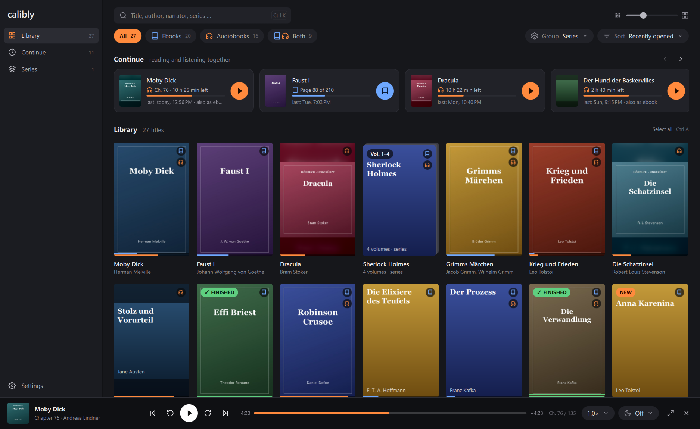
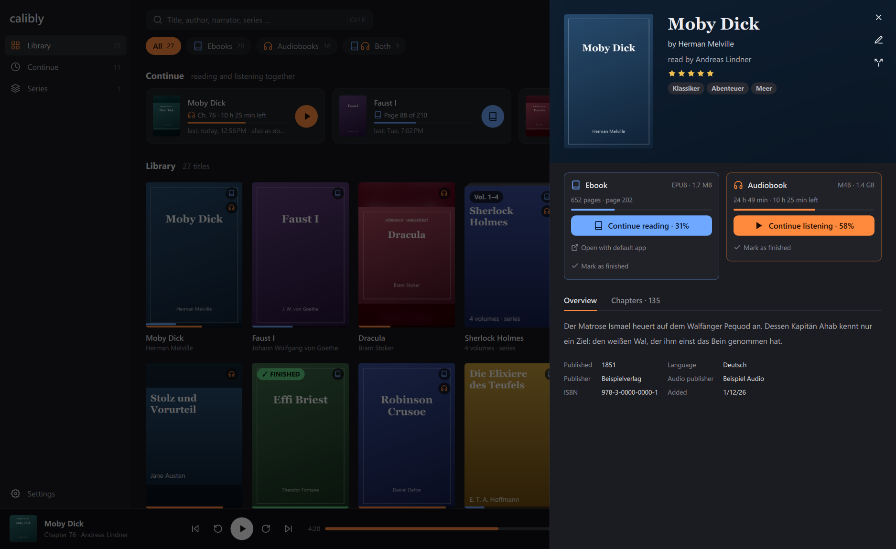
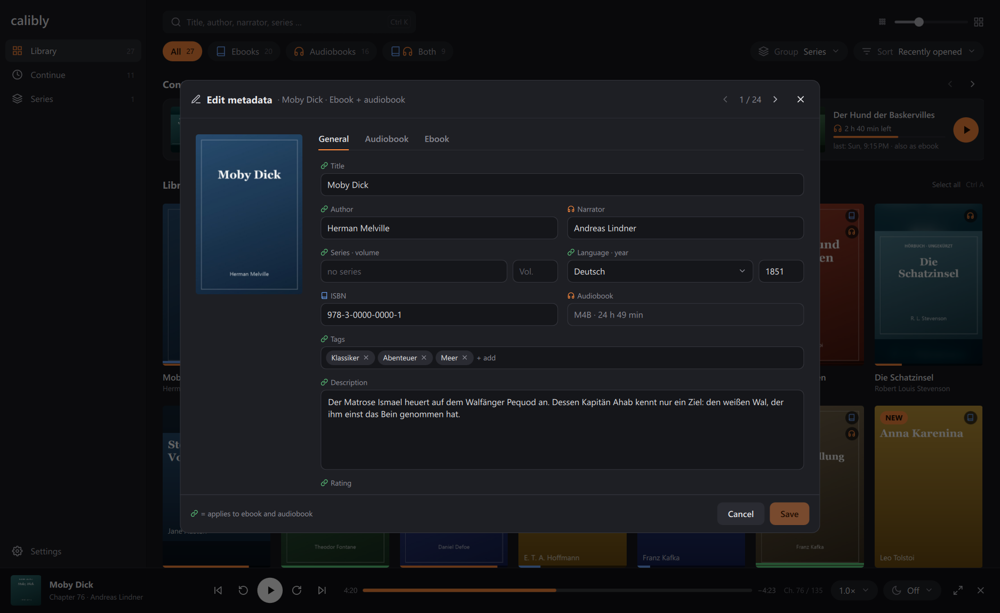
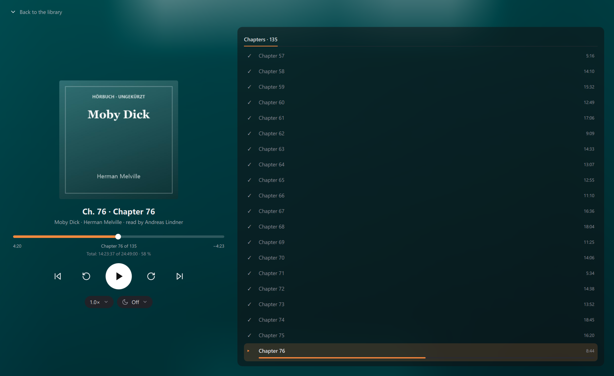
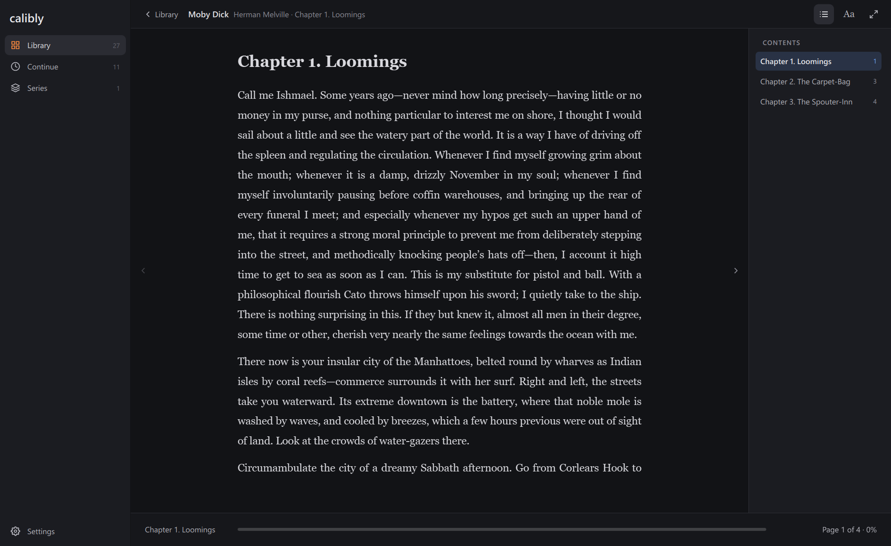
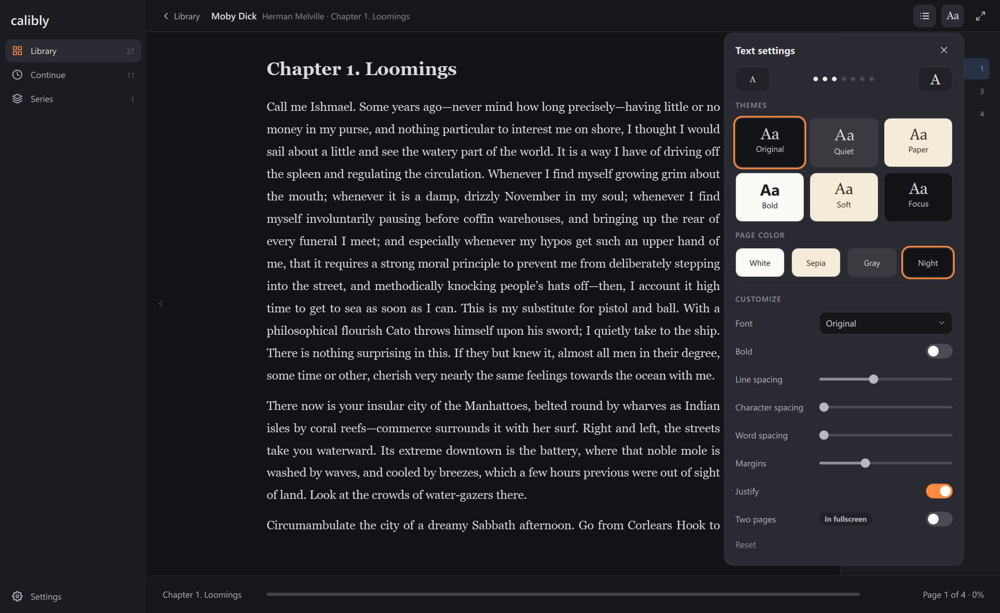
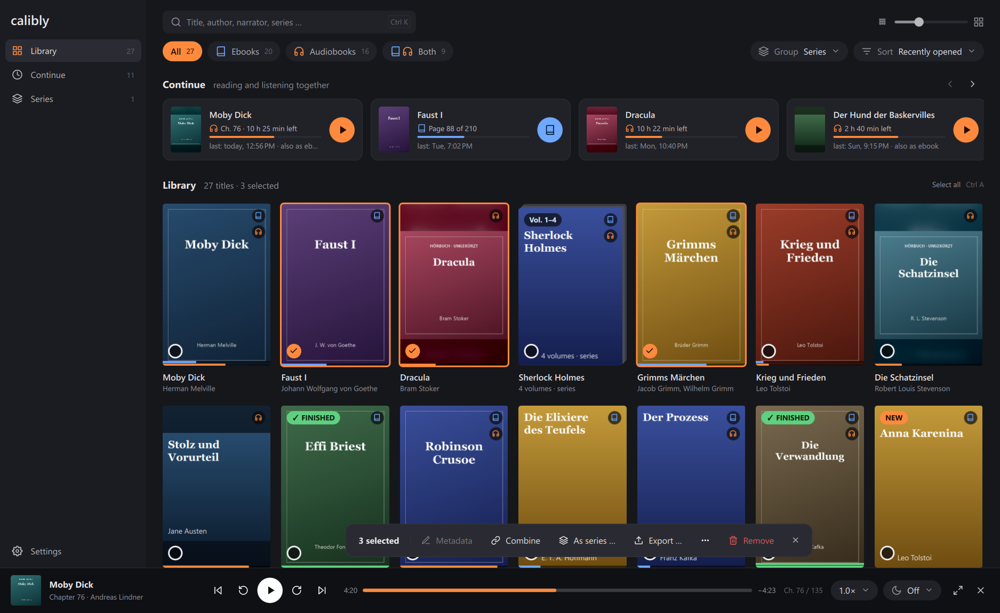
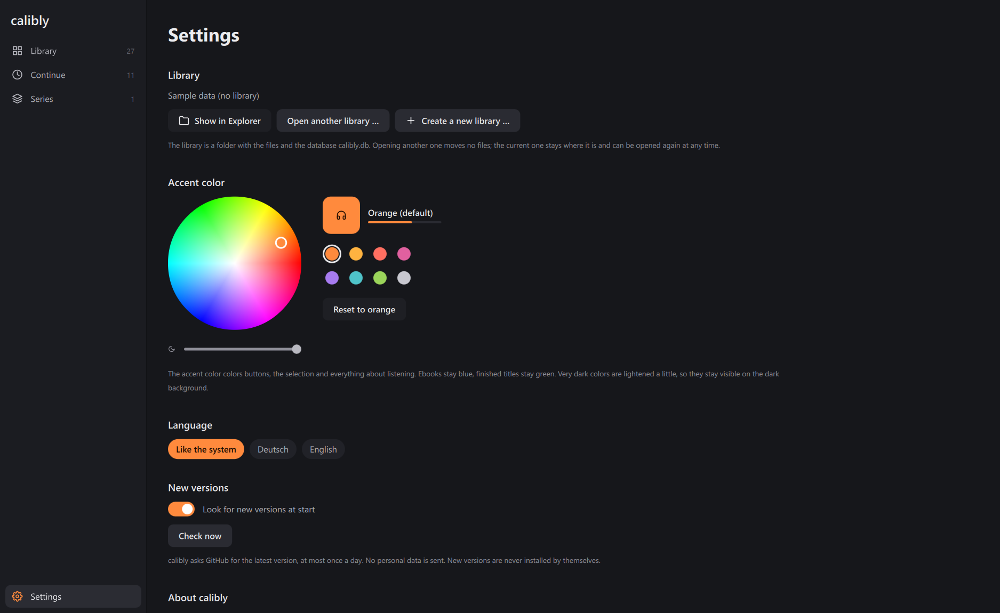

# calibly
One library for ebooks and audiobooks - calibre's library management combined with an Audibly-style audiobook player.

## Design



## Compatibility
- Main target: Windows 11
> Developed with later Linux compatibility in mind. Versions for Android and iOS are thinkable in the future.

## Features
- Classical calibre interface which also accepts audiobooks.
- Modify the metadata of audiobooks and ebooks the same way you can modify ebooks in calibre.
- Integrated player for audiobooks similar to Audibly.
- Integrated reader for ebooks (EPUB and PDF) with text settings like Apple Books.
- Importing ebooks (EPUB, PDF, MOBI, AZW3) and audiobooks (M4B, M4A, MP3, AAC, OGG, Opus, FLAC) by pulling the files in the interface.
- Export selected titles: their files are copied into a folder of your choice, split into `Ebooks` and `Audiobooks`.
- Group selected titles as a series, or combine them into one entry that reads and plays on from volume to volume (and dissolve it again).
- Mark selected titles as finished or as new.
- Select series stacks like single titles (all their volumes), and dissolve a series again.
- Choose the accent color with a color wheel in the settings.

## Usage
The screenshots show the sample library of the development build in English.

### Library
- **Add titles** with "Add" or by dragging files or whole folders into the window:
  - dropped on free space they become new titles,
  - dropped on a cover they become a format of that title (e.g. the audiobook of an ebook),
  - the MP3 files of one folder become one audiobook.
- The **import queue** at the bottom right shows each title; "Review" opens the metadata of titles whose name could only be taken from the file name.
- **Continue** at the top shows the titles opened last that are not finished; the round button continues directly, and so do "Read" / "Listen" when hovering a cover. "Continue" in the sidebar lists all started titles.
- **Labels** on the covers: "NEW" until a title is opened for the first time, "FINISHED", "FILE MISSING" when a file is no longer in the library folder.
- **Series** are shown as one stack; a click opens it, "‹" or Esc leads back. "Group: None" shows every volume on its own, "Series" in the sidebar lists all series.
- A **right click** on a cover opens a menu with the actions for that title.

### Details and metadata


- A click on a cover opens the **detail view**: one card per format with "Continue reading" / "Continue listening", "Open with default app" and "Mark as finished"; below it the overview and the chapters.
- ✎ opens the **metadata editor**. Fields marked with 🔗 apply to all formats of the title, the others only to the audiobook or the ebook.
- Ctrl+S saves, Ctrl+PgUp / Ctrl+PgDown go to the previous / next title.



### Listening


- "Continue listening" starts the **player bar** at the bottom; it opens the fullscreen player with the chapter list, speed and sleep timer.
- Space plays / pauses, ← / → skip 30 seconds.
- The position is saved, and the last audiobook is ready again after a restart.

### Reading


- "Read" opens EPUB, PDF, plain text and Markdown files in the reader inside the window. Other formats such as MOBI open in the default application.
- The contents are on the right, "Aa" opens the **text settings**: text size, six themes, page color (white, sepia, gray, night), font, bold, line / character / word spacing, margins, justified text and two pages in fullscreen. For PDFs it shows the zoom instead.
- The place is saved, "Continue" shows the chapter or page, and the last page marks the ebook as finished.

| Key | Action |
|---|---|
| ← / →, PgUp / PgDn, Space, mouse wheel, click on the left / right third | Turn pages |
| Home / End | Start / end of the book |
| Ctrl + / Ctrl − | Text size |
| F11 or the fullscreen button | Fullscreen (only the page; moving the mouse shows the bars) |
| Esc | Leave fullscreen, a second Esc closes the book |



### Selecting several titles


- **Select** with the circle at the bottom left of a cover, with Ctrl + click or with Ctrl + A; Esc ends the selection. While titles are selected, a click on a cover selects it too.
- A **series stack** is selected like a single title and stands for all its volumes.
- The **bar** at the bottom then offers:

| Action | What it does |
|---|---|
| Metadata | Edits the metadata (exactly one title). |
| Combine | Joins the titles into one entry, e.g. an ebook and its audiobook, or the volumes of a series: "Read" opens the current volume and goes on in the next one at its end, audiobooks play one after the other. "Dissolve combination" (right click or detail view) turns it back into single titles. |
| As series … | Gives the titles one series name; existing volume numbers stay, missing ones are given. "Dissolve series …" (right click on a stack) and "Remove from series" undo it. |
| Export … | Copies the files into a folder of your choice, split into `Ebooks` and `Audiobooks`; "Cancel" deletes an unfinished export. |
| ⋯ | Marks all as finished or as new. |
| Remove | Moves the files in the library folder to the recycle bin. |

### Settings


"Settings" at the bottom of the sidebar:
- **Library:** open another library or create a new one (no files are moved).
- **Accent color:** color wheel, brightness and eight quick choices; ebooks stay blue.
- **Language:** like the system, German, English.
- **New versions:** calibly asks GitHub for the list of releases at most once a day (nothing else is sent) and shows a hint with a download link; it never installs anything by itself.
- **About calibly:** version, license terms, third-party notices and log files.

### Library folder and data
- The library lives in `Documents\calibly-Bibliothek`: imported files are copied there (sorted by author and title) together with the database `calibly.db`.
- If the library cannot be opened (e.g. it is on a drive that is not connected, or its database is damaged), calibly says so and offers to try again, to open another library or to create a new one. It never creates a new library in place of one that was used before.
- Before a new version changes the database, it is copied to `calibly.db.v<old version>-<date>.bak` (the newest three are kept).
- Only one calibly works with a library at a time (`calibly.lock`); starting it again brings the open window to the front.
- Messages are logged to `%LOCALAPPDATA%\calibly\logs` (one file per day, kept for 14 days) – useful for bug reports.

## UI Development Plan
The UI is built with Qt Quick, in small phases that each end with a runnable app. The [UI Development Plan](docs/UI-Development-Plan.md) describes the concept, the modular architecture and the phases. The [Release Plan](docs/Release-Plan.md) lists what is left until 1.0; what changed in each version is in the [Release Notes](docs/Release-Notes.md).

## Build
Requirements: Qt 6.12 (6.12.0 is tested; calibly uses Qt's internal `QZipReader` for EPUB files, so check the EPUB tests after a Qt update) with **MinGW 64-bit** and **Qt Multimedia** (Additional Libraries), plus **CMake** and **Ninja** from the Qt Online Installer (under "Build Tools"). Optional: **Qt PDF** (Extensions) for PDF covers and reading PDFs in calibly. TagLib is downloaded and built automatically on the first configure (needs internet once). The presets expect Qt in `C:\Qt`; if it is installed elsewhere, change `QT_ROOT` in `CMakePresets.json`.

Run the commands in the project folder. If `cmake` is not on your `PATH`, use `C:\Qt\Tools\CMake_64\bin\cmake.exe`.

```bash
cmake --preset mingw-debug
cmake --build --preset mingw-debug
cmake --build --preset mingw-debug --target run
```

Run the unit tests (Qt Test):

```bash
ctest --preset mingw-debug
```

Further targets:
- `run-gallery` starts the component gallery (all UI building blocks with sample data).
- `all_qmllint` checks all QML files.
- `update_translations` collects all UI texts into `i18n/*.ts`.

Command line options of `calibly.exe`:
- `--language <code>` starts with a UI language, e.g. `en`.
- `--library <folder>` uses this library folder instead of the last used one (default `Documents\calibly-Bibliothek`).
- `--import <path>` imports a file or folder after start, as if it was dropped on the gallery; can be given several times.

Development options, only in builds with the CMake option `CALIBLY_DEV_TOOLS` (on in `mingw-debug`, off in `mingw-release`; the sample library is built in only then, too):
- `--gallery` shows the component gallery instead of the library.
- `--size <W>x<H>` sets the initial window size, e.g. `1900x1000`.
- `--screenshot <file>` saves a screenshot of the window and quits.
- `--mock <file.json>` reads the library from your own JSON file in the format of `resources/mock/mock.json`, e.g. to try the app with real files. Relative file paths are relative to the JSON file.

`--mock :/mock/mock.json` shows the built-in sample library (`resources/mock/mock.json`); its files do not exist, so "Read" and "Listen" are disabled there. The sample covers are generated with `powershell -ExecutionPolicy Bypass -File tools/generate-mock-covers.ps1`. The screenshots in `docs/images` show this sample library (`--language en`, `--screenshot`), with a real EPUB and audio file for "Moby Dick".

### Release
Requirements in addition to the above: [Inno Setup 6](https://jrsoftware.org/isinfo.php) (`winget install JRSoftware.InnoSetup`), Python 3 and the Qt documentation (installed with Qt by default; both are needed for the third-party notices). Then:

```bash
powershell -ExecutionPolicy Bypass -File tools/make-release.ps1
```

It configures and builds the preset `mingw-release`, runs the tests, writes the complete program folder to `build/mingw-release/deploy` (`cmake --install`, which runs Qt's `windeployqt`) and packs it with `installer/calibly.iss` into `build/mingw-release/installer/calibly-<version>-setup.exe`. The installer installs for the current user only (no admin rights) and never touches the library. The version, its suffix (`beta`), publisher and the releases page are set at the top of `CMakeLists.txt`. The app icon is generated with `powershell -ExecutionPolicy Bypass -File tools/generate-icon.ps1` (`resources/icon`). calibly's license terms are `LICENSE.txt` / `LICENSE.de.txt` (shown by the installer); `THIRD-PARTY-NOTICES.txt` in the installed folder is generated by `tools/generate-third-party-notices.py` during `cmake --install` and lists every third-party component with its license (texts in `licenses/`). The steps towards the first public release are in the [Release Plan](docs/Release-Plan.md).

## Translations
UI texts are written in German and translated with Qt Linguist. The English translation is in `i18n/calibly_en.ts`. After changing or adding texts, run `update_translations`, translate the new entries (e.g. with `C:\Qt\6.12.0\mingw_64\bin\linguist.exe`) and build again. Start with a specific language with `--language en`. The language can be switched at runtime, as shown in the component gallery. Details are in the [UI Development Plan](docs/UI-Development-Plan.md#translations).
